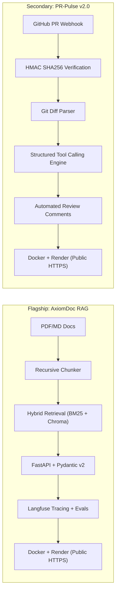

# Q4 2026 Applied AI Engineer Blitz (October 14 – December 31, 2026)

> **Objective:** Transition from script prototypes to an **Internship-Ready Applied AI Engineer** by December 31, 2026, while building an active open-source track record for **GSoC 2027** and protecting an **8.43+ CGPA**.

---

## 🎯 The Three Hard Targets (By Dec 31, 2026)
1. **Ship 2 True Production Systems:**
   - **Flagship (PROJ-03):** AxiomDoc Enterprise RAG Engine (FastAPI, Pydantic v2, ChromaDB, Hybrid BM25+Dense Search, Langfuse tracing, Docker, Render deploy).
   - **Secondary (PROJ-04):** PR-Pulse v2.0 Code Review Webhook (FastAPI, GitHub HMAC verification, schema-enforced tool calling, pytest suite, Docker, Render deploy).
2. **2 Substantive Open Source PRs:** Active contributor record in **LiteLLM** (`BerriAI/litellm`) or **Chroma** (`chroma-core/chroma`) to establish early credibility for GSoC 2027.
3. **Internship Pipeline Active:** Resume v3.0 deployed with quantified engineering metrics, 50 targeted cold outreaches across NCR (Gurgaon/Noida/Delhi) and remote AI teams.

---

## 🛑 The Explicit CUT LIST (What We Stop Doing Immediately)
To ensure 100% completion by December 31 without burning out or jeopardizing university grades:
* 🛑 **STOP** working on **PROJ-08 (Jarvis Desktop Agent)**. Multi-modal OS control and voice agents are a distraction for Q4. Deferred to 2027.
* 🛑 **STOP** working on **PROJ-01 (Gurgaon Rent Predictor)**. Tabular Scikit-Learn regression is already done and does not demonstrate modern LLM engineering depth.
* 🛑 **STOP** working on **PROJ-06 (Digital Catalog AI)**. Single-script Gemini calls are redundant.
* 🛑 **STOP** chasing multi-agent hype (unconstrained autonomous swarms, CrewAI, AutoGen). Production hiring in 2026 demands reliable, deterministic, single-agent tool use with structured outputs.
* 🛑 **STOP** tutorial hoarding. Every hour spent coding must directly advance AxiomDoc, PR-Pulse, or your open-source PR.

---

## ⚡ The Dual-Engine Portfolio

---

## 📅 The 11-Week Master Execution Schedule

*Weekly Time Commitment: 15–18 focused hours + 20% academic buffer reserved for college exams and assignments.*

| Week | Dates | Main Objective | Tasks | Est. Hours | Deliverable | Definition of Done | Evidence Created | Risk & Mitigation |
| :---: | :---: | :--- | :--- | :---: | :--- | :--- | :--- | :--- |
| **W1** | **Oct 14 – Oct 20** | **AxiomDoc Core & Vector DB** | Integrate ChromaDB with existing chunker; implement dense embedding pipeline; write vector query tests. | 16 | Local RAG Pipeline | `pytest tests/` passes with 6+ tests verifying ingestion & retrieval accuracy. | GitHub commit with passing local tests. | *Risk:* Windows ChromaDB SQLite lock.  *Mitigation:* Use in-memory or headless client. |
| **W2** | **Oct 21 – Oct 27** | **FastAPI Ingestion & Query APIs** | Build `/ingest` and `/query` endpoints using Pydantic v2 schemas; implement error handlers and rate limits. | 16 | FastAPI RAG Service | Swagger docs at `localhost:8000/docs` accepting PDFs and returning source-grounded answers. | Video capture / Postman collection committed. | *Risk:* Pydantic v1 vs v2 conflicts.  *Mitigation:* Follow pure v2 syntax from `fastapi-learning`. |
| **W3** | **Oct 28 – Nov 03** | **Observability & Hybrid Search** | Connect Langfuse tracing; implement BM25 + dense Reciprocal Rank Fusion (RRF); log latency & cost metrics. | 16 | Observable RAG Engine | Langfuse web dashboard displays complete trace tree with latency and token costs for queries. | Screenshot of live Langfuse trace in project README. | *Risk:* Langfuse self-host complexity.  *Mitigation:* Use Langfuse Cloud free tier. |
| **W4** | **Nov 04 – Nov 10** | **Containerization & Deployment** | Write multi-stage `Dockerfile`; write GitHub Actions CI for `pytest`; deploy to Render/Railway. | 15 | Live AxiomDoc API | Public HTTPS URL responding to live queries with automated Swagger UI. | Green CI badge on repo; live public URL. | *Risk:* Render free tier memory (512MB).  *Mitigation:* Use lightweight `fastembed` models. |
| **W5** | **Nov 11 – Nov 17** | **AxiomDoc Documentation & Evals** | Create architecture diagram; record 90s Loom demo; compile 20-question evaluation dataset with precision metrics. | 14 | Flagship Release | Polished README with architecture diagram, live link, eval scores, and Loom demo. | Pinned repo on GitHub profile with detailed case study. | *Risk:* Perfectionism on video.  *Mitigation:* Limit demo to 60-90s walkthrough. |
| **W6** | **Nov 18 – Nov 24** | **Academic Buffer & OSS Groundwork** | University assignment buffer; study `BerriAI/litellm` repo structure; set up local test environment. | 12 | OSS Groundwork | Forked repo, passing local test suite, 1 drafted issue/fix. | Forked repo on GitHub; academic assignments submitted on time. | *Risk:* College workload spike.  *Mitigation:* Pause coding; focus 100% on academic CGPA. |
| **W7** | **Nov 25 – Dec 01** | **PR-Pulse Webhook & Parsing** | Set up FastAPI webhook receiver; implement GitHub HMAC secret verification; parse pull request diffs. | 16 | Webhook Service | Webhook accepts simulated PR payloads and validates signature securely. | Unit tests verifying HMAC pass/fail validation. | *Risk:* Localhost webhook testing.  *Mitigation:* Use `ngrok` or `localtunnel` for testing. |
| **W8** | **Dec 02 – Dec 08** | **PR-Pulse Tool Engine & OSS PR #1** | Connect LLM with structured outputs for code review; submit 1st PR to `BerriAI/litellm`. | 18 | PR-Pulse V1 & Open PR | PR-Pulse posts comments on test PR; PR submitted to open-source upstream. | Public PR link on GitHub upstream; review comments on test repo. | *Risk:* Slow maintainer response.  *Mitigation:* Submission quality is the primary metric. |
| **W9** | **Dec 09 – Dec 15** | **PR-Pulse Deploy & OSS PR #2** | Containerize PR-Pulse; deploy to Render; submit 2nd open-source PR / documentation improvement. | 16 | Deployed Webhook Engine | PR-Pulse active on live test repo; 2 total open-source PRs active. | 2 live deployed projects online with health endpoints. | *Risk:* Deployment configuration errors.  *Mitigation:* Reuse proven Dockerfile from AxiomDoc. |
| **W10** | **Dec 16 – Dec 22** | **Resume & Portfolio Overhaul** | Redesign Resume v3.0 with quantified metrics; polish GitHub profile README; create 50-company target list. | 14 | Application Toolkit | ATS-optimized 1-page PDF resume; updated LinkedIn featuring project deep-dives. | Public resume link; verified spreadsheet of 50 NCR/remote companies. | *Risk:* Weak bullet formatting.  *Mitigation:* Use XYZ formula (Action + Method + Metric). |
| **W11** | **Dec 23 – Dec 31** | **Targeted Outbound & Review** | Send 25 personalized outreach emails/InMails to Founders, Tech Leads, and Engineering Managers; conduct year-end audit. | 12 | Active Candidate Pipeline | 25 personalized messages sent with demo links; portfolio live and ready for January screening. | Sent messages log; scheduled interviews or follow-ups. | *Risk:* Holiday response slowdown.  *Mitigation:* Target early-stage seed founders in NCR. |

---

## 🌐 Open-Source & GSoC 2027 Strategy

Instead of spraying speculative PRs across random repositories, focus deeply on high-velocity AI infrastructure:

### Primary Target: [`BerriAI/litellm`](https://github.com/BerriAI/litellm)
* **Why LiteLLM:** LiteLLM is the universal proxy for 100+ LLMs used across the entire AI ecosystem. Maintainers actively merge PRs, welcome first-time contributors, and the entire stack is pure asynchronous Python with Pydantic.
* **Contribution Ladder:**
  1. *Level 1 (Week 6):* Fix docstrings, documentation code snippets, and add missing type annotations.
  2. *Level 2 (Week 8):* Add missing unit test cases for edge-case HTTP status codes, error parsers, or retry timeouts.
  3. *Level 3 (Week 9):* Add or update provider-specific parameter schemas.

### Secondary Target: [`chroma-core/chroma`](https://github.com/chroma-core/chroma)
* **Focus:** Python client utility fixes, hybrid search documentation examples, and client testing fixtures.

---

## 📚 Curated Free Resources Hub (Everything You Need)

Zero paid courses required. Master modern Applied AI engineering using the highest-quality free resources available:

### 1. Backend, FastAPI & Pydantic v2
* **[FastAPI Official Tutorial & In-Depth Guide](https://fastapi.tiangolo.com/tutorial/):** The gold standard documentation for async routes, dependency injection, and error handling.
* **[Pydantic v2 Documentation & Migration Guide](https://docs.pydantic.dev/latest/):** Deep dive into `BaseModel`, `field_validator`, `model_validator`, and performance optimizations.
* **[TestDriven.io: Developing and Testing an Asynchronous API with FastAPI and Pytest](https://testdriven.io/blog/fastapi-crud/):** Comprehensive free guide on testing FastAPI endpoints with fixtures and test databases.

### 2. Retrieval, ChromaDB & Vector Embeddings
* **[DeepLearning.AI: Advanced Retrieval for AI with Chroma](https://www.deeplearning.ai/short-courses/advanced-retrieval-for-ai/):** Free 1-hour course by Chroma co-founders covering dense retrieval, query expansion, and cross-encoder reranking.
* **[ChromaDB Official Getting Started Guide](https://docs.trychroma.com/getting-started):** Vector indexing, metadata filtering, and embedding functions in Python.
* **[FastEmbed by Qdrant (GitHub)](https://github.com/qdrant/fastembed):** Fast, lightweight, local Python library for generating embeddings without downloading heavy PyTorch binaries.
* **[Pinecone Learning Center: Hybrid Search Explained](https://www.pinecone.io/learn/hybrid-search-intro/):** Clear explanation of Sparse (BM25) + Dense retrieval fusion via Reciprocal Rank Fusion (RRF).

### 3. Observability, Tracing & Evaluation (Evals)
* **[Langfuse Official Documentation & Quickstart](https://langfuse.com/docs):** Setup guides for Python SDK, OpenAI/Groq wrappers, trace trees, token tracking, and cost measurement (free cloud tier available).
* **[DeepLearning.AI: Building & Evaluating Advanced RAG Applications](https://www.deeplearning.ai/short-courses/building-evaluating-advanced-rag/):** Learn the RAG Triad (Context Relevance, Groundedness, Answer Relevance) using TruLens/Ragas principles.
* **[Ragas Documentation (RAG Assessment)](https://docs.ragas.io/en/stable/):** Industry-standard framework for reference-free evaluation of retrieval and generation pipelines.

### 4. Automated Testing & Code Quality
* **[Corey Schafer: Python Pytest Tutorial Series (YouTube)](https://www.youtube.com/playlist?list=PL-osiE80TeTsCAcT4Zqi2v-i4h4ePZ3F-):** The clearest practical tutorial on test fixtures, parameterized tests, and assertions.
* **[Real Python: Python Mocking and Unit Testing with unittest.mock](https://realpython.com/python-mock-library/):** Essential guide to mocking external HTTP calls, databases, and LLM APIs so your test suite runs fast and offline.
* **[Ruff Linter & Formatter Docs](https://docs.astral.sh/ruff/):** Blazing fast Python linter to enforce PEP 8 style standards automatically.

### 5. Docker, CI/CD & Deployment
* **[Docker Curriculum by Prakhar Srivastav](https://docker-curriculum.com/):** Best beginner-to-intermediate hands-on tutorial for containerizing web apps, writing multi-stage `Dockerfile`s, and managing ports.
* **[GitHub Actions for Python Developers (Official Guide)](https://docs.github.com/en/actions/automating-builds-and-tests/building-and-testing-python):** Step-by-step instructions to create `.github/workflows/ci.yml` that runs pytest and ruff on every push.
* **[Render Documentation: Deploy a FastAPI Web Service](https://render.com/docs/deploy-fastapi):** Free hosting setup with automatic SSL and GitHub auto-deployments.

### 6. Open Source & GSoC Playbooks
* **[Google Summer of Code Student Guide](https://google.github.io/gsocguides/student/):** Official guide on how to approach maintainers, write winning proposals, and submit clean PRs.
* **[First Contributions GitHub Repository](https://github.com/firstcontributions/first-contributions):** Hands-on practice repository for forking, branching, committing, and submitting pull requests.
* **[LiteLLM Contributing Guide](https://github.com/BerriAI/litellm/blob/main/CONTRIBUTING.md):** Step-by-step local development setup instructions for LiteLLM.

### 7. Resume & Strategic Outreach
* **[Harvard Mignone Career Center: Resumes & Action Verbs](https://careerservices.fas.harvard.edu/resources/bullet-point-resume-action-verbs/):** Action-oriented vocabulary to write impactful engineering bullet points.
* **[Jake's Resume (Overleaf LaTeX Template)](https://www.overleaf.com/latex/templates/jakes-resume/syzfjbzwjncs):** The universal clean ATS-friendly standard resume template used across top tech candidates.
* **[Career-OS Networking System](file:///C:/Users/kavya/Documents/antigravity/fearless-faraday/05_NETWORKING/NETWORKING_SYSTEM.md):** Your internal repository guide for crafting personalized, value-first founder messages without sounding desperate.

---

## 🏆 Definition of Success (December 31, 2026)
* [ ] **AxiomDoc RAG** is live on Render with automated Swagger UI, 15+ passing unit tests, and Langfuse tracing.
* [ ] **PR-Pulse v2.0** is live, listening to GitHub webhooks, validating signatures, and posting review comments.
* [ ] **2 Substantive PRs** submitted/merged in `BerriAI/litellm`.
* [ ] **Resume v3.0** published with live project links and verified test coverage metrics.
* [ ] **25+ Targeted Outreaches** sent to NCR AI founders, CTOs, and tech leads.
* [ ] **CGPA maintained at 8.40+** at IILM University.
